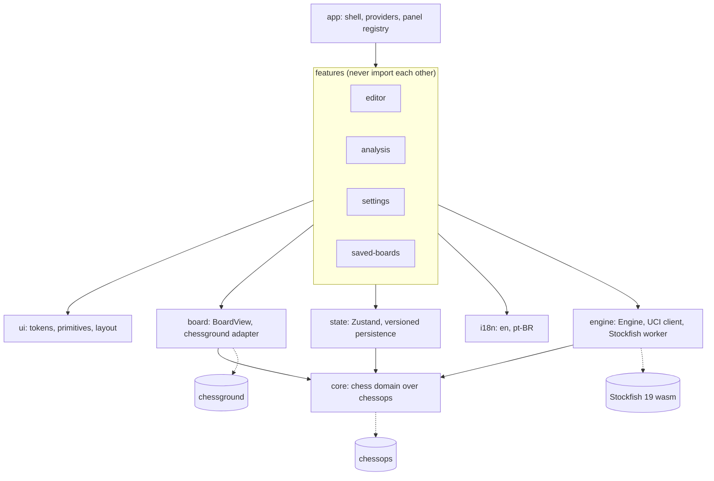

# Next-Move Calculator

Open-source web app, inspired by nextchessmove.com: set up any chess position and get the best move(s), evaluation and lines, computed 100% in your browser on phone, tablet and desktop. No backend.

## Features

- **Set up any position**: spare-piece palette, drag and drop, tap-to-place, eraser, side to move, castling rights, en passant; or paste a FEN or PGN. Illegal positions are shown with every reason and cannot be analyzed.
- **Best moves, evaluation and lines** from Stockfish 19 running in a Web Worker: eval from White's point of view (`+0.35`, mates as `#3`), a who's-winning bar beside the board (above it on phones) that follows the board orientation, 1–5 lines, depth and time limits, arrows on the board, click any move to play it.
- **Play moves** on the board (legal moves only), step through the move list, undo and redo, import and export PGN.
- **Lite or Full engine**: Lite (~2 MB) by default; Full (~94 MB, strongest) is opt-in and cached after the first download. Threads and hash follow the device.
- **Saved boards**, settings (language, theme, board colors, piece style, notation, auto-queen) and keyboard shortcuts, remembered in the browser with versioned migrations.
- **English and Brazilian Portuguese**, light and dark themes.
- **Phone, tablet and desktop**, portrait and landscape; touch, mouse, pen and keyboard. 100% client-side: no backend, no analytics, no request leaves the page.

## Requirements

- Node.js 24 (LTS), see `.nvmrc`
- npm

## How to run

```sh
npm install
npm run dev        # development: http://localhost:5173
```

`npm install` also copies the Stockfish builds into `public/engine/` (git-ignored). Set `ENGINE_SIZES=lite` to skip the ~190 MB of Full builds.

### Production build, locally

```sh
npm run build      # typecheck + static bundle in dist/
npm run preview    # serves dist/ with COOP/COEP: http://localhost:4173
```

### On another device on your network (a tablet, say)

`npm run preview` (and `npm run dev`) listen on every interface and print the address:

```
  ➜  Local:   http://localhost:4173/
  ➜  Network: http://192.168.1.20:4173/
```

Open the **Network** address on the tablet, on the same Wi-Fi. Two modes:

| Command               | Tablet opens | What you get                                                                                                                                                        |
| --------------------- | ------------ | ------------------------------------------------------------------------------------------------------------------------------------------------------------------- |
| `npm run preview`     | `http://…`   | Everything, with a single-threaded engine. Browsers allow threads, Cache Storage and copy-to-clipboard only in a secure context.                                    |
| `npm run preview:lan` | `https://…`  | Everything, multi-threaded (except on Safari and iOS, which always use one thread), Full engine cached. Self-signed certificate: accept the browser's warning once. |

If the tablet cannot connect, check the computer's firewall and that both devices are on the same network (guest Wi-Fi often isolates clients). See [ADR 0013](docs/adr/0013-local-release-and-lan.md).

## Scripts

| Script                                  | What it does                                                                                                                                                             |
| --------------------------------------- | ------------------------------------------------------------------------------------------------------------------------------------------------------------------------ |
| `npm run dev` / `preview`               | Dev / production-preview server (both send COOP/COEP)                                                                                                                    |
| `npm run engine:fetch`                  | Copy the Stockfish builds into `public/engine/` (runs on install, dev and build)                                                                                         |
| `npm run fonts:glyphs`                  | Rebuild the committed chess-symbol font for the text-symbol piece theme (ADR 0017)                                                                                       |
| `npm run build`                         | Typecheck and build the static bundle into `dist/`                                                                                                                       |
| `npm run check:bundle`                  | Fails if the initial load of `dist/` is over the 250 kB gzip budget or loads the engine with the page                                                                    |
| `npm run preview:lan`                   | Preview over HTTPS (self-signed) for a secure context on other devices                                                                                                   |
| `npm run lint`                          | ESLint, including layer-boundary rules                                                                                                                                   |
| `npm run typecheck`                     | `tsc -b` (strict)                                                                                                                                                        |
| `npm run format` / `format:check`       | Prettier                                                                                                                                                                 |
| `npm test` / `test:watch`               | Vitest unit and component tests                                                                                                                                          |
| `npm run test:e2e`                      | Playwright on desktop Chromium/Firefox/WebKit and phone/tablet profiles (run `npx playwright install` once); `E2E_BASE_URL=<url>` tests a server that is already running |
| `npm run storybook` / `build-storybook` | Component catalog                                                                                                                                                        |
| `npm run check`                         | lint + typecheck + test + build                                                                                                                                          |

## Architecture



```
app → features → (ui, board, state, i18n) → (engine, core)
```

Lower layers never import higher ones; this is enforced by ESLint (`eslint.config.js`) and covered by `tools/layer-rules.test.ts`. Each module exposes a public `index.ts`; other modules import only that. Third-party libraries (chessground, chessops, stockfish) are used only inside their adapter. See [`docs/adr/`](docs/adr/) for decisions.

```
src/
  core/      pure chess domain over chessops
  engine/    Engine interface, Stockfish worker adapter, UCI client
  board/     BoardView interface, chessground adapter
  ui/        design system: tokens, primitives, layout (shadcn/ui)
  i18n/      translations (en, pt-BR) and locale detection
  state/     Zustand stores (theme, locale, settings, analysis settings, saved boards: persisted, versioned, migrated; editor document; analysis session)
  features/  editor, analysis, settings, saved-boards
  app/       shell, providers, panel registry
```

## Chess core

`src/core/` is the pure TypeScript chess domain over chessops (no React, no DOM; other layers never see chessops types). It provides:

- `Setup` (editable, not-necessarily-legal position) with FEN parse/make and editing helpers; `validateSetup` lists every problem with a code and severity.
- `Position` (legal, immutable): legal moves/destinations, `play`, SAN and UCI conversion, status (check, mate, stalemate, insufficient material).
- `MoveHistory` with undo/redo, and PGN import/export.
- `toWhiteScore` / `formatEval` / `formatEvalCompact` / `whiteShare`: engine scores from White's point of view, mates as `#N`, a four-character form for the eval bar, and White's winning chance.

See [ADR 0005](docs/adr/0005-chess-core-domain.md). Standard chess only.

## Engine

`src/engine/` exports the `Engine` interface and `createStockfishEngine({ size: 'lite' | 'full' })`; features never see Stockfish, UCI or workers.

```ts
const engine = createStockfishEngine() // Lite; threads when cross-origin isolated (not on WebKit)
const search = engine.analyze(position, { limits: { depth: 20 }, multiPv: 3 })
for await (const event of search.events) {
  if (event.type === 'info')
    show(event.searchId, event.info) // score is from the side to move
  else done(event.reason, event.move) // 'completed' | 'stopped' | 'superseded' | 'disposed' | 'failed'
}
```

- Every search has an id that is on all its events; a new `analyze` stops the old search and waits for it, so a stale result can never appear. `superseded` results must be ignored.
- `engine.subscribe` reports status and download progress (`LoadProgress`); Full (~94 MB) is downloaded once and cached in Cache Storage.
- `detectCapabilities`, `recommendedSettings` and `fullEngineWarnings` give device-aware defaults; `engine.configure({ threads, hashMb })` applies at the next search. Safari and every iOS browser (WebKit) always get the single-threaded build, because the threaded one can hang there ([ADR 0014](docs/adr/0014-single-threaded-engine-on-webkit.md)).
- To add an engine, implement `Engine`, or for any UCI engine give `UciEngine` a `connect()` that returns a `UciTransport`.

See [ADR 0008](docs/adr/0008-engine-layer.md).

## Board

`src/board/` exports `Board` (React), `PieceIcon`, `PromotionPicker` and the `BoardView` interface; chessground is used only in `chessground-adapter.ts`. The board is controlled and has three modes: `view`, `play` (legal moves from core's `Position.destinations()`, promotion picker included) and `edit` (free moves, drag off to delete, tap-to-place `EditTool`, palette drag via the `ref` and `useSparePieceDrag`, which keeps a tap on a spare piece a tap on every input). Arrows and highlights are props. It works with touch, mouse, pen and keyboard (arrows, Enter/Space, Escape, Delete) and announces moves to screen readers. Board themes (`green`, `brown`, `blue`) are token sets; piece themes (`classic`, `glyph`) are CSS. The text-symbol (`glyph`) theme draws from a bundled font whose glyphs are centred in the em box, so they are centred on every browser ([ADR 0017](docs/adr/0017-text-symbol-pieces.md)). See [ADR 0006](docs/adr/0006-board-layer.md). Every mode has a Storybook story (`board/Board`).

## Position editor

`src/features/editor/` fills the board slot (`EditorBoard`) and registers three panels (position, FEN/PGN, moves). Two modes: **Edit position** (spare-piece palette that works with touch, mouse, pen and keyboard: tap or click a piece, then tap squares to place it as often as you like, or drag it onto the board; eraser tool; drag pieces around, drop them off the board to delete, Delete key; moving a king two files castles when the right is set, and rights the pieces can no longer hold are dropped; side to move, castling rights, en passant square; start, clear, flip, undo, redo) and **Play moves** (legal moves only, building a move list you can step through). Paste a FEN or PGN into the FEN box to load it, copy the FEN or PGN back out. An invalid position is still shown, with every reason listed (and translated), and cannot be analyzed or played from: `useEditorSnapshot().position` is defined exactly when a position is legal, which is what the analysis feature will consume. See [ADR 0007](docs/adr/0007-position-editor.md) for castling, [ADR 0015](docs/adr/0015-castling-in-the-editor.md), and for palette input, [ADR 0016](docs/adr/0016-spare-piece-palette-input.md).

## Analysis

`src/features/analysis/` registers two panels: **Analysis** (Calculate/Stop, evaluation from White's point of view as `+0.35` or `#3`, the best move, depth, speed, nodes and time, and the engine's lines in SAN) and **Search settings**. The best move is drawn on the board as an arrow, with fainter thin arrows for the other lines. Pick any move in a line, or the best move, to play it on the board (as one undo step).

- Limits: time 1–60 s or until stopped, optional depth (whichever is reached first ends the search), 1–5 lines. Threads and hash memory are offered within what the browser and device allow (no threads control without cross-origin isolation). Settings are remembered and apply to the next calculation.
- **Auto-move** (Search settings, off by default): when a search ends by its time or depth limit, its best move is played on the board, castling and promotion included. It is one undo step, the old lines disappear, and nothing recalculates. Stop never moves. With "Until stopped" and no depth limit, the switch explains that it needs a limit. See [ADR 0019](docs/adr/0019-auto-move.md).
- Recalculating is manual: changing the position (or playing a move) clears the analysis and stops any search; press Calculate again. A search is stopped when the tab goes to the background and can be restarted.
- Output is throttled to 10 updates a second so a phone stays smooth; the engine runs in a worker.
- The board and the analysis meet only in `app/AnalysisBoard.tsx` (`EditorBoard` takes an `arrows` prop), because features do not import each other. See [ADR 0009](docs/adr/0009-analysis-feature.md).
- **Who's winning bar** (`BoardEvalBar`): White's winning chance on lichess's curve, so small evals move it gently; a forced mate fills it, and it shows the eval in short (`+0.4`, `#3`). It sits in the `gauge` slot of `ui/BoardStage`, which composes it with the board in `app/AnalysisBoard.tsx`: vertical beside the board side by side, horizontal above it when stacked. White's part grows from the end of the side at the bottom of the board. It is a `meter` with the full eval as its text value. See [ADR 0018](docs/adr/0018-eval-bar-beside-the-board.md).

## Settings, shortcuts and saved boards

- **Settings** (gear button in the header) hold language, theme, board colors, piece style, move notation (standard `Nf3`, figurine `♘f3`, coordinates `g1f3`), "always promote to a queen", engine size and keyboard shortcuts on/off. **Lite** is the default engine; **Full** (~94 MB, strongest, cached after the first download) asks first and warns on phones, low-memory devices and browsers without threads. A new engine size applies to the next calculation.
- **Keyboard shortcuts**: `F` flip the board, `Ctrl/⌘+Z` undo, `Ctrl/⌘+Shift+Z` redo, `M` edit/play, `←`/`→` previous/next move, `Shift+←`/`Shift+→` first/last move, `Ctrl/⌘+Enter` calculate or stop, `?` the list. They never run while you type in a field, and can be turned off in the settings. Each feature registers its own with `useShortcuts` (see `src/ui/shortcuts`), so the help dialog lists whatever exists.
- **Saved boards** (panel): name the board on screen (with its moves, if it has any, and which side is at the bottom), load it later, rename or delete it. Up to 100, kept in this browser.
- **Persistence is versioned.** Every persisted store (`nmc-theme`, `nmc-locale`, `nmc-analysis`, `nmc-settings`, `nmc-saved-boards`) carries a schema `version`. To change a schema: bump the version, add `migrations[oldVersion]` (see `state/savedBoards.ts` and `state/analysis.ts`, which each went from version 1 to 2), and add a test that loads the old payload. Corrupt or newer data is repaired field by field, never dropped wholesale. See [ADR 0010](docs/adr/0010-settings-persistence-shortcuts.md).

## Design system

- **Tokens** live in [`src/ui/styles/tokens/`](src/ui/styles/tokens) (colors per theme, board, typography, shape, layout, motion, z-index) and are mapped into Tailwind by `src/ui/styles/theme.css`. Components use only those utilities; `npm test` rejects raw colors and px/rem values outside token files, mismatched light/dark token sets and WCAG AA contrast failures.
- **Re-theme** by editing token files only. Add a theme by defining the same token names under a new selector; board themes use `[data-board-theme="..."]`.
- **Theme** is `system` (default), `light` or `dark`, switchable in the settings dialog; it follows the OS live and is remembered.
- **Primitives** (shadcn/ui, restyled via tokens) are in `src/ui/primitives`, each with a Storybook story. Controls are compact for mouse and >= 44 px on touch.
- **Storybook** (`npm run storybook`) has theme and locale toolbars and the viewport toolbar for phone/tablet/desktop.

## Shell and panels

The shell (`src/app/Shell.tsx`, `src/ui/layout`) has a header, a board slot and a panel slot: stacked with the board first on phones and portrait tablets, side by side on desktop and in landscape. New panels are registered, never added to the shell:

```ts
import { registerPanel } from '@/app'

registerPanel({ id: 'analysis', order: 10, component: AnalysisPanel })
```

Call it from `registerDefaultPanels` in `src/app/panels/defaults.ts`.

## Internationalisation

Every string goes through `useTranslation()`. Core strings are in `src/i18n/locales`; a feature registers its own namespace with `registerTranslations`. English is the default; Brazilian Portuguese (pt-BR) is complete, and `src/app/translations.test.ts` fails if any namespace misses a key, a `{{placeholder}}` or a translation. To add a language, add a locale file per namespace and list it in `src/i18n/locales.ts`. See [ADR 0004](docs/adr/0004-i18n.md).

## Quality

- **Tests**: unit and component tests (Vitest, Testing Library), including the layer rules, design-token contrast and translations; end-to-end tests (Playwright) with the real engine on the production build across desktop Chromium/Firefox/WebKit, phone and tablet profiles — editor, castling (both sides, both colors, every input path), analysis, auto-move (on/off, Stop, castling, promotion), the eval bar (placement, orientation, cp curve, mates), settings, saved boards, the full set-up → calculate → play → save flow, and a keyboard-only flow. Text-symbol pieces are measured on screenshots (centred on the board and in the palette) and compared with per-project visual snapshots; after an intended visual change run `npx playwright test e2e/glyph-pieces.spec.ts --update-snapshots` (Linux baselines come from CI, see ADR 0017).
- **Accessibility**: axe (WCAG 2.x A/AA) runs on the built app in light, dark, pt-BR and with dialogs open; Tab order, focus indicators and focus return are tested. Rationale and the problems the pass found: [ADR 0012](docs/adr/0012-accessibility-verification.md).
- **Performance**: the engine downloads on the first Calculate, never with the page; dialogs and the saved-boards panel load on demand; `npm run check:bundle` holds the initial load (currently ~215 kB gzip) under 250 kB. See [ADR 0011](docs/adr/0011-loading-performance.md).
- **CI** (GitHub Actions): format, lint, typecheck, unit tests, build, bundle budget, Storybook build, and the e2e suite.

## Decisions

Short ADRs in [`docs/adr/`](docs/adr/): [stack](docs/adr/0001-stack.md), [layers](docs/adr/0002-layered-architecture.md), [tokens and theming](docs/adr/0003-design-tokens-and-theming.md), [i18n](docs/adr/0004-i18n.md), [chess core](docs/adr/0005-chess-core-domain.md), [board](docs/adr/0006-board-layer.md), [editor](docs/adr/0007-position-editor.md), [engine](docs/adr/0008-engine-layer.md), [analysis](docs/adr/0009-analysis-feature.md), [settings and persistence](docs/adr/0010-settings-persistence-shortcuts.md), [loading performance](docs/adr/0011-loading-performance.md), [accessibility](docs/adr/0012-accessibility-verification.md), [local release and LAN](docs/adr/0013-local-release-and-lan.md), [single-threaded engine on WebKit](docs/adr/0014-single-threaded-engine-on-webkit.md), [castling in the editor](docs/adr/0015-castling-in-the-editor.md), [spare-piece palette input](docs/adr/0016-spare-piece-palette-input.md), [text-symbol pieces](docs/adr/0017-text-symbol-pieces.md), [eval bar beside the board](docs/adr/0018-eval-bar-beside-the-board.md), [auto-move](docs/adr/0019-auto-move.md).

## Hosting requirements

The build is a static bundle. For multi-threaded Stockfish (`SharedArrayBuffer`) any host must serve every response with:

```
Cross-Origin-Opener-Policy: same-origin
Cross-Origin-Embedder-Policy: require-corp
```

Without these the app falls back to single-threaded mode (Safari and iOS always use it, see ADR 0014). Also:

- **HTTPS** (or `localhost`): cross-origin isolation, Cache Storage (Full engine cache) and the clipboard need a secure context.
- Serve `engine/*.wasm` as `application/wasm` (up to ~99 MB per file; Full builds are in `dist/engine/`) and `engine/*.js`; allow same-origin blob workers.
- Serve `assets/*.otf` as `font/otf` (the text-symbol piece font).
- Serve `index.html` without long caching (assets under `assets/` are content-hashed and can be cached forever).
- Everything is a same-origin static file: no server code, no CORS, no third-party origins (a CDN would also need `Cross-Origin-Resource-Policy`).

Hosting itself is out of scope for the first release.

## License

[GPL-3.0](LICENSE). The classic piece sprites are cburnett (GPL-2.0-or-later); the text-symbol piece font is derived from Noto Sans Symbols 2 ([OFL-1.1](src/board/styles/pieces/glyph/OFL.txt)).
